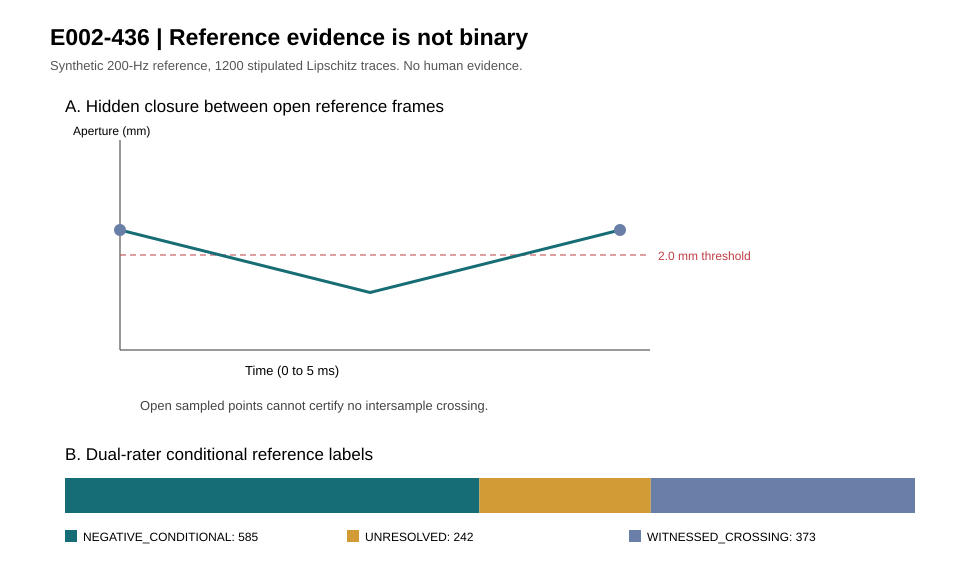

# E002-436 — exact dual-rater reference-envelope adjudication

**Date:** 2026-10-25. **Frozen protocol:** [E002_436_FROZEN.md](E002_436_FROZEN.md), committed before implementation (`0d767d3`). **Evidence:** reproducible synthetic reference instrument and adversarial software validation; **not** human physical validation, not an externally verified velocity bound, and not a novel claim about the basic Lipschitz-cone principle.

## New measurement-science result

A high-speed *reference* camera does not automatically yield a trustworthy negative blink label. Lucent's prospective E002-426 registry supports `NEGATIVE_CONDITIONAL` labels but does not itself adjudicate two independent physical-aperture raters. E002-436 implements that missing reference layer, with an exact conservative lower envelope for a stipulated speed cap and bounded sample-clock error. It requires physical scale and sensor-time attestations, consistent rater intervals, explicit nuisance visibility, and a bounded reference sampling gap. These are **externally supplied declarations**, not authenticated by the code.

For sample times \(t_i\), jointly consistent rater lower aperture bounds \(l_i\), a *stipulated* physical Lipschitz speed bound \(V\) and per-sample clock uncertainty \(\delta\), the conditional reference lower envelope is

\[
L_*(a,b)=\min_{t\in[a,b]}\max_i\{l_i-V(|t-t_i|+\delta)\}.
\]

This is an exact minimum of the **conservative cone envelope**. It is not necessarily the sharpest physically feasible lower bound once correlated clock errors and upper measurement intervals are incorporated. Between adjacent sample times, the cone envelope is the maximum of a decreasing and an increasing affine function. Their intersection, clipped to each segment, gives the exact minimum in linear time after prefix/suffix maxima. Independent dense-time numerical checks confirm the implementation. A conditional negative requires \(L_*>\theta\), with all other provenance and nuisance gates satisfied; equality abstains.

**Important falsification discovered during development:** a boundary-frame closure whose timestamp uncertainty overlaps the evaluation interval must not be counted as an in-interval witnessed crossing; it must also block a contradictory negative label. A second adversarial case exposed that using the *intersection* of two rater intervals to declare a witnessed crossing can accidentally accept a crossing asserted by only one rater. Both issues were corrected before the final experiment. A dual-rater witness now requires **both** upper limits below threshold at the same frame, with its entire timing interval inside the target interval.

## Frozen predictions and synthetic results

The executable generated 1,200 deterministic **synthetic** piecewise-linear aperture trajectories with continuous speeds bounded by 120 mm/s, sampled as 200-Hz references with independent synthetic rater intervals, a 0.1-ms clock uncertainty, and a 2.0-mm hypothetical closure threshold. The continuous truth was generated at 4,000 Hz. All physical attestation flags in the fixture are **synthetic assumptions**.

| Reference adjudication | Synthetic intervals |
| --- | ---: |
| `NEGATIVE_CONDITIONAL` | **585** |
| `WITNESSED_CROSSING` | **373** |
| `UNRESOLVED` | **242** |
| Actual synthetic trajectories with crossing | **432** |
| Crossings retained as unresolved | **59** |
| Noncrossings retained as unresolved | **183** |
| False conditional negatives against synthetic truth | **0** |

This is **not** a real-world error-rate estimate: the generator enforces the very Lipschitz premise the adjudicator uses, and synthetic rater intervals are guaranteed to contain the true sample aperture. The 59 unresolved crossings *within the synthetic world* show why an unwitnessed event must not be promoted to a negative. No real participants were recorded.

An additional adversarial triangular trajectory crosses the 2.0-mm threshold between apparently open 2.1-mm reference frames. The reference gate returns `UNRESOLVED` instead of a verified negative. Twelve adversarial unit tests, including a seeded-benchmark test, passed locally, covering rater disagreement, single-rater positive, clock overlap, invalid metadata, missing frames, speed incompatibility, nuisance rejection and an independent dense-time oracle.



## Independent literature and source eligibility

Two focused source checks found no immediately executable, licensed, **individual-level physically calibrated eyelid-aperture** recordings with verified raw exposure times for this run. The [EyeInfo dataset](https://github.com/fabricionarcizo/eyeinfo) reports 150-fps eye tracking from 83 people, but its public access requires an interactive DVC/Google Drive authorization and its annotations primarily describe pupil/glint coordinates rather than registered physical eyelid aperture. [GazeBase](https://www.nature.com/articles/s41597-021-00959-y) provides 1,000-Hz gaze and pupil-area data from 322 participants, not physical eyelid margin measurements. Neither can validate E002-371's physical shutter-gap law without additional independent calibration. The stronger [FaceBase 400-fps 3D eyelid-margin release](https://trackhub.facebase.org/2026/09/01/recent-release-clites-eyelid-kinematics-emg/) remains controlled access. No restricted dataset was accessed, and no ordinary-camera event label was treated as physical ground truth.

## Reproduction and prospective study handoff

From the repository root, using only Python standard library:

```sh
PYTHONPATH=research/observability python -m unittest -v research/observability/test_e002_436_dual_rater.py
PYTHONPATH=research/observability python research/observability/e002_436_benchmark.py --trials 1200 --seed 436 --output /tmp/e002_436.json --figure /tmp/e002_436.svg
python research/observability/e002_436_dual_rater.py --private-trial /private/blinded_reference_trial.json --output /private/adjudication.json
```

For the **first authorized human study**, independently archive the E002-426 prediction registry and seal before either blinded rater's reference labels are revealed. Collect E002-433's authenticated hardware exposure times, scale/geometry calibration, illumination and shutter characterization, and independent upper/lower eyelid landmark intervals. Have two blinded raters annotate separately, run E002-436 on private reference records, and feed only its frozen labels into E002-426's participant-disjoint scorer. Preserve `UNRESOLVED` rather than treating it as a successful prediction. Keep raw imagery, personal identifiers and any unlicensed derived data out of public GitHub/CI. Independently validate the physical speed bound or **do not produce reference-negative labels**.

## Product consequence and limits

The only justified product behavior is **fail-closed reference adjudication** and transparent measurement diagnostics. Two apparent open samples, two raters saying “no observed closure,” a camera's advertised high frame rate, or self-asserted calibration hashes are insufficient for a physical negative. E002-371 **remains physically unvalidated**. Lucent continues `ABSTAIN_UNCALIBRATED` for physical no-hidden-closure guarantees, blink duration, PERCLOS and fatigue. A production release requires independent calibration and review, real participant-disjoint evidence, and a product-specific threat/measurement model.
