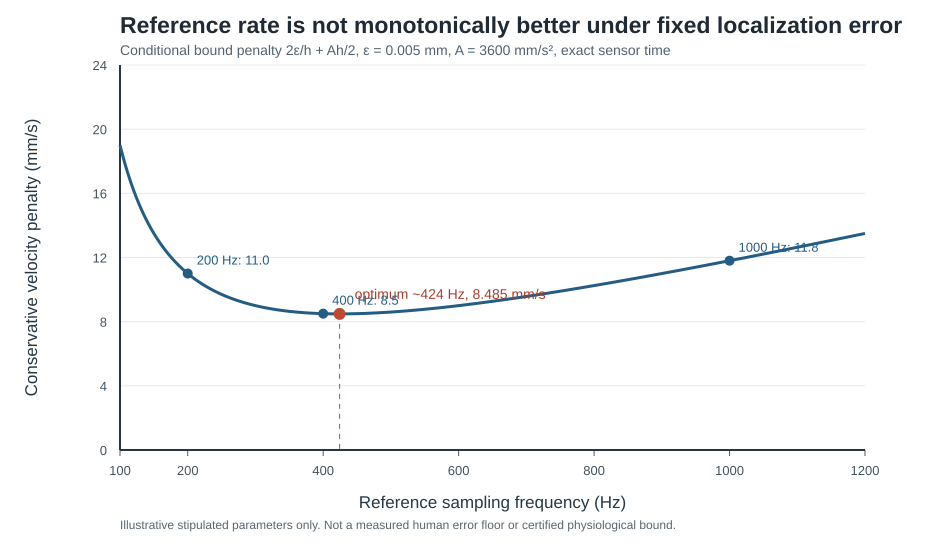

# E002-437 — acceleration-conditioned reference velocity bridge

**Date:** 2026-10-25. **Frozen before implementation:** [E002_437_FROZEN.md](E002_437_FROZEN.md), commit `c11e355a5e17c9a081dedfe51dca9552ee141978`. **Evidence:** elementary analytic inequality, sharp synthetic equality case, independent smooth-trajectory oracle, and fail-closed research instrument. **Zero new human physical aperture traces.** This does not validate E002-371 on humans.

## Scientific result and priority

For true physical aperture \(x(t)\) with an **independently justified** acceleration bound \(|x''|\le A\), nominal reference sampling separation \(h\), independently bounded aperture localization errors \(|y_i-x(t_i^*)|\le\epsilon\), and per-frame hardware time error \(|t_i^*-t_i|\le\delta\), with \(h>2\delta\), a conservative physical velocity bound over the *true* intersample interval is

\[
\sup |x'(t)| \le \frac{|y_{i+1}-y_i|+2\epsilon}{h-2\delta}+\frac{A(h+2\delta)}2. \tag{1}
\]

The first term bounds the true secant over the shortest possible true interval; the second bounds the deviation between instantaneous derivative and segment mean by the Lipschitz acceleration cap over the longest possible true interval. This is a standard mean-value/Lipschitz argument, **not a novel general theorem**. Its contribution here is a concrete, falsifiable bridge from reference samples to the independent velocity premise required by E002-371. It is valid only on the actual intervals between the physically observed samples, not beyond the reference sequence's support. Any unavailable independent acceleration limit or unbounded nuisance blocks the bridge.

With exact sample times, the penalty above the observed secant is \(B(h)=2\epsilon/h+Ah/2\). For positive \(\epsilon,A\), it is minimized at \(h_*=2\sqrt{\epsilon/A}\), giving \(B_*=2\sqrt{\epsilon A}\). **More reference frames can worsen the worst-case velocity envelope when each frame retains fixed absolute landmark uncertainty.** This is a conditional sampling-design consequence, not an assertion about actual human camera accuracy.

## Frozen synthetic predictions: all reproduced locally

| Reference rate | Hypothetical penalty (mm/s) |
| --- | ---: |
| 200 Hz | 11.0 |
| 400 Hz | **8.5** |
| 1000 Hz | 11.8 |
| Optimal continuous rate | **424.264 Hz**, penalty **8.4853 mm/s** |

Parameters are \(\epsilon=0.005\) mm and \(A=3600\) mm/s², **stipulated solely for the synthetic fixture**. The 500 seeded sinusoidal smooth-trajectory trials had **0 conditional inequality violations** against an independent analytic derivative oracle. The maximum true-speed-minus-bound was **−0.465507 mm/s**. This is a verification of the mathematics under enforced assumptions, not a real-world false-certificate rate.

The adversarial quadratic \(x(t)=2+30t-1800t^2\), \(h=2.5\) ms, with opposite-sign ±0.005-mm endpoint errors, has true initial velocity **30 mm/s** but measured secant **21.5 mm/s**. Equation (1) gives exactly **30.0 mm/s** (sharp equality). Falsely assuming zero acceleration gives **25.5 mm/s**; falsely assuming zero localization error gives **26.0 mm/s**. Both invalid premises **underestimate a witnessed instantaneous velocity**. A speed cap derived from observed secants alone must not be used to certify hidden-closure exclusion.



## Reproducibility and adversarial controls

The standard-library implementation requires explicit per-frame flags for geometry, brightness, missingness, blur, gaze, glasses, sampling, clock, occlusion and shutter. It rejects nonmonotone frames/timestamps, ambiguous clock ordering, missing frame IDs, gaps exceeding the frozen maximum, malformed physical units, and absent acceleration or scale attestations. **Attestation booleans and external-reference strings are not authenticated by software**. Even a finite conditional reference bound never authorizes a product certificate.

```bash
PYTHONPATH=research/observability python -m unittest -v research/observability/test_e002_437_velocity_bridge.py
PYTHONPATH=research/observability python research/observability/e002_437_velocity_bridge.py --traces 500 --output /tmp/e002_437.json
PYTHONPATH=research/observability python research/observability/e002_437_figure.py --output /tmp/e002_437.svg
```

Thirteen local adversarial tests passed, including analytic sharpness, independent smooth-trajectory derivative checks, misspecified acceleration/error falsifications, explicit nuisance rejection, invalid timestamps and fail-closed product behavior. Dedicated hosted verification must be checked separately; local pass is not CI pass.

## Prospective human acquisition consequence

This bridge makes the missing measurement premise explicit. A high-frame-rate camera alone supplies **secants**, not a hard continuous-time velocity cap. To use Equation (1) on real eyelids, first independently bound physical acceleration **and** two-rater anatomical localization error, while authenticating the camera exposure clock and geometry. An empirical maximum acceleration on finitely many people cannot establish a universal physiological hard bound. If the independent \(A\) assumption cannot be defended, use the method only for **conditional sensitivity analysis**, never as a physical closure guarantee. See [E002_437_HUMAN_HANDOFF.md](E002_437_HUMAN_HANDOFF.md).

**E002-371 remains physically unvalidated.** The existing E002-407 human clips establish rater-instrument feasibility, not completed human ratings or physical calibration. Keep `ABSTAIN_UNCALIBRATED` for physical no-hidden-closure, blink duration, PERCLOS and fatigue. Do not merge or deploy until external measurement review and prospective unseen-participant validation.
