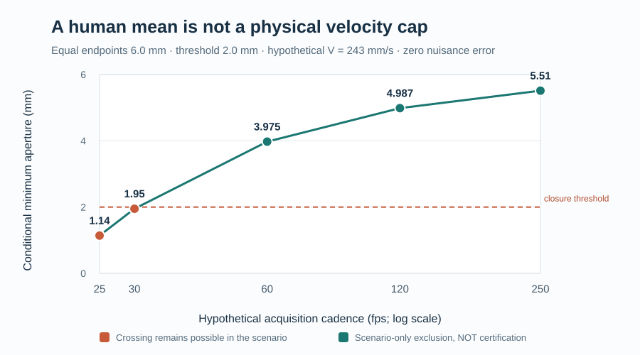

# E002-438 — published human velocities falsify a low hard-cap scenario

**Date:** 2026-10-25. **Frozen first:** [E002_438_FROZEN.md](E002_438_FROZEN.md), commit 30738242ec0cc4fb5951f35c2c43ea8e2b4ff9ad. **Evidence tier:** independent *published human aggregate* plus exact necessary-speed inequality and synthetic analytic oracle. **No new participant-level eyelid traces, no hard physiological velocity cap, and no E002-371 human physical validation.**

## Decisive empirical constraint from primary literature

Kwon et al., *J R Soc Interface* 2013, [DOI 10.1098/rsif.2013.0227](https://doi.org/10.1098/rsif.2013.0227), acquired voluntary blink videos from **25 healthy volunteers at 600 fps**, measuring physical palpebral aperture at **5-ms** increments. The paper reports a **mean peak closing speed of 243 ± 9 mm/s**. The reported ±9 is **not** a deterministic physical measurement-error bound; this experiment does not use it as one.

Under the explicit assumption that the published mean summarizes participant-level measured peak closing speeds, at least one participant's measured peak must be at least the group mean. Allowing 0.5 mm/s for integer rounding, a purported **universal 120-mm/s peak closing-speed cap is incompatible with the reported measured cohort**, conditional on comparable anatomical metric and acquisition calibration. This is a **falsification of the low-cap scenario**, not a validation of 243 mm/s, 300 mm/s or any other hard cap. Raw individual-level values were not obtained; we do not infer an individual maximum, distribution tail, or universal human upper bound.

The independently published 2026 reflex/spontaneous comparison [DOI 10.1080/08164622.2026.2619492](https://doi.org/10.1080/08164622.2026.2619492) reports a **177.7 mm/s reflex-minus-spontaneous closing-phase velocity difference** (95% CI 102.2–253.1) among 11 participants. It demonstrates substantial *blink-type* heterogeneity but does **not** share the 2013 study's peak metric or cohort, so its number must **not** be added to 243. A separate 2026 500-fps acquisition study, [DOI 10.1016/j.jtos.2026.01.003](https://doi.org/10.1016/j.jtos.2026.01.003), reports that maximum eyelid velocities were markedly underestimated below 250 fps, especially in reflex blinks. This reinforces the need for a high-rate reference; it does not provide a hard cap.

## Dimensionless decision consequence

For two **equal** independently calibrated physical-aperture endpoint observations a separated by a known gap Δ, a **hypothetical** physical speed upper bound V, aperture error ε, and sample clock error δ, the conditional lower envelope at the midpoint is

L = a − ε − V(Δ+2δ)/2.

Define the dimensionless margin R = (a−ε−θ)/(V(Δ+2δ)), where θ is the closure threshold. A conditional no-crossing certificate would require **R > 1/2** and independently validated physical premises. This is a sharp special case of E002-371, **not a new theorem**.

Using a=6.0 mm, θ=2.0 mm, ε=δ=0 and V=243 mm/s *solely as an illustrative scenario*, the lower envelopes are:

| Hypothetical cadence | Midgap lower aperture | Scenario decision |
| ---: | ---: | --- |
| 25 fps | 1.140 mm | unresolved |
| 30 fps | **1.950 mm** | **unresolved** |
| 60 fps | 3.975 mm | conditional exclusion if premises held |
| 120 fps | 4.9875 mm | conditional exclusion if premises held |
| 250 fps | 5.514 mm | conditional exclusion if premises held |

**None of these are physical certifications.** The published *mean* of 243 mm/s is not a velocity upper bound, so even the seemingly safe 60–250-fps scenarios remain **ABSTAIN_UNCALIBRATED** in the actual product. This changes the engineering priority: collecting more low-rate frames cannot compensate for a missing independently defensible speed bound.

## New falsification-only calibrated-pair instrument

For two independently calibrated human aperture observations y0,y1 with each absolute error ≤ ε, per-frame clock error ≤ δ and nominal separation h, the mean-value inequality yields the **necessary** lower bound

V_required ≥ max(0, |y1−y0|−2ε)/(h+2δ).

A proposed upper cap V is **falsified** whenever this necessary lower bound exceeds V. The reverse is invalid: observing no contradiction **does not establish** V as an upper bound. This avoids assuming any acceleration cap and provides a direct preregistered test for future high-speed human traces.

An independent linear synthetic oracle x(t)=2+250t over 5 ms with opposite-sign ±0.01-mm endpoint errors produces measured separation 1.23 mm and a necessary lower bound of **242 mm/s**. It conditionally rejects a 240-mm/s candidate. No synthetic trace is presented as a human observation.

The instrument requires explicit geometry, brightness, missingness, blur, gaze, glasses, sampling, clock, occlusion and shutter flags; it rejects unauthenticated scale/timing declarations, invalid times, malformed physical units and nonfinite values. The attestation booleans themselves are **not cryptographically authenticated**. A private calibrated-pair record must never be uploaded to GitHub Actions.

## Reproducibility and human-validation gate

The Python-standard-library instrument and independent adversarial tests are [e002_438_human_velocity_witness.py](e002_438_human_velocity_witness.py) and [test_e002_438_human_velocity_witness.py](test_e002_438_human_velocity_witness.py). The dedicated [CI workflow](../../.github/workflows/e002_438_human_velocity_witness.yml) independently checks the literature-derived rejection, exact linear oracle, all ten nuisance gates and product abstention.

Run from repository root:

~~~sh
PYTHONPATH=research/observability python -m unittest -v research/observability/test_e002_438_human_velocity_witness.py
python research/observability/e002_438_human_velocity_witness.py --output /tmp/e002_438.json
# Optional private study only:
python research/observability/e002_438_human_velocity_witness.py --private-pair /private/calibrated_pair.json --output /private/witness.json
~~~

**13 local adversarial tests passed** on the implementation. Hosted verification must be checked separately; do not claim hosted success from a local pass.

Two targeted searches this run found no immediately downloadable individual-level *physically calibrated* eyelid aperture traces with authenticated sensor timing. The open [IREye4Task dataset](https://ireye4task.github.io/dataset.html) has annotated human eyelid boundaries but is a wearable infrared research dataset, not authenticated ordinary-RGB physical millimeters; [GazeBase](https://www.nature.com/articles/s41597-021-00959-y) has 1000-Hz pupil/gaze, not calibrated eyelid aperture. The restricted high-rate physical references already documented in E002-436 remain potential prospective sources. **Do not repeat source archaeology without a genuinely usable trace.**

For prospective validation, freeze candidate speed caps and participant-disjoint spontaneous/reflex strata before label release. Obtain consented independently calibrated 400–600-fps physical aperture and shutter/clock records with two blinded anatomical raters; run the falsification-only witness on all eligible high-rate pairs. Report candidate-cap violations by participant and nuisance stratum. Only then attempt E002-371 ordinary-camera predictions, retaining unresolved references and product abstention whenever hard speed/geometry/time premises cannot be independently justified.

**Completion status:** published human evidence rejects the **120-mm/s universal peak-speed scenario** (under metric comparability), but E002-371 remains **physically unvalidated**. No hard velocity bound, human unseen-condition certification, blink duration, PERCLOS or fatigue claim is authorized. Keep **ABSTAIN_UNCALIBRATED**; keep draft PR #26 unmerged.
