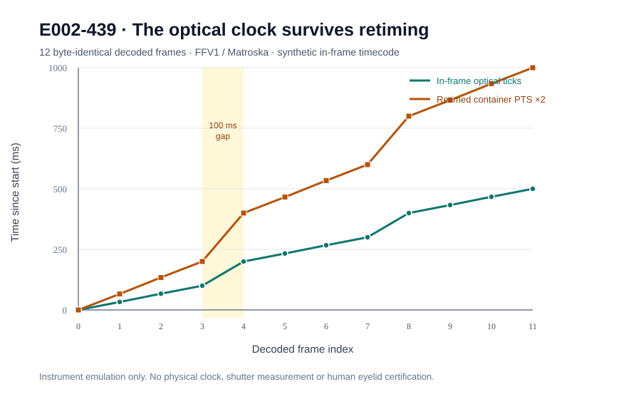

# E002-439 — in-frame optical-clock witness survives media retiming, but not shutter mixing

**Date:** 2026-10-25. **Parent:** E002-371. **Frozen before implementation:** [E002_439_FROZEN.md](E002_439_FROZEN.md), commit `11cb533f20f8c3374aa99994ec894e0b0fc9b0ae`. **Evidence:** real FFmpeg/FFprobe encoding-decoding and synthetic virtual optical frames. **Not** human data, independent hardware timing, a new theorem, or physical eyelid validation.

## Scientific question and experimental result

E002-434/435 found that container timestamps can differ from sensor exposure time, and even identical video frames can be assigned incompatible presentation times. E002-439 tests a constructive alternative for a future laboratory validation rig: place an externally clocked optical code **inside** the acquired image and measure its preservation independently of container timestamps. This experiment implements only the *software emulation* of that optical code; it does not build an independently driven LED rig.

The frozen virtual-clock schedule uses 12 frames, a stipulated 1,000-tick/s oscillator, and authored ticks `[0,33,67,100,200,233,267,300,400,433,467,500]`. Each 64×32 RGB frame carries a 16-bit Gray-coded tick, CRC-8/SMBUS, and eight alternating reference cells. The frames are encoded as lossless FFV1/Matroska, decoded independently with FFmpeg, and re-encoded with **2× container presentation timestamps**. The original decoded frames and the retimed decoded frames are byte-identical (verified SHA-256); the optical tick sequence is unchanged.

| Directly observed instrument property | Original video | Retimed video |
| --- | ---: | ---: |
| Decoded frames | 12 | 12 |
| Final container PTS | 500 ms | **1,000 ms** |
| Final recovered in-frame tick (virtual ms) | **500** | **500** |
| Largest optical interframe gap | **100 ms** | **100 ms** |
| All decoded image SHA-256 values identical | yes | yes |
| Physical camera exposure authenticated | **no** | **no** |

The 100-ms gap is three times a nominal 30-fps frame interval. A decoder that reconstructs timing from frame index / nominal FPS cannot recover it. A source media PTS happens to match the authored schedule in this controlled fixture, but is not a physical timestamp. Re-encoding changes PTS while preserving the optical payload and decoded images. Dropping a frame preserves its remaining optical tick differences; duplicate or reordered ticks are rejected.



## Adversarial controls and newly exposed limitation

All **13 local adversarial test groups passed**. Tests include a published CRC-8 check vector, independently known Gray code, all 24 single-bit optical-cell flips, under/over-exposure gain changes (0.7× and 1.3×), saturation, invalid frame sizes/ticks, dropped frames, duplicated/reordered frames, and real FFmpeg encoder/decoder verification. The instrument correctly refuses to treat its synthetic clock as an authenticated physical sensor timebase.

**Negative result:** CRC-8 is an error detector, not a proof of exposure-time coherence. The distinct virtual ticks **1322 and 14003** have identical CRC-8 values. A synthetic rolling-shutter splice using the upper 16 data bits of tick 1322 and the lower checksum/fiducial rows of tick 14003 produces an image **identical** to tick 1322. The decoder accepts it. Thus, a single in-frame counter can be insufficient to determine row-level exposure timing even when the image is lossless and the CRC passes. This does not demonstrate that a physical camera has this failure probability; it is an exact constructed alias under the stipulated row-splice model.

A further limitation is adversarial replay or replacement of the optical pixels: no image-embedded counter cryptographically authenticates itself. LED switching latency, rolling shutter, exposure integration, bit transitions during exposure, geometry, illumination, blur, glare, glasses, missing frames, and clock drift remain to be independently bounded. These limitations are release blockers, not implementation bugs to paper over.

## Priority audit: optical timecode is established technology

Do **not** claim invention of optical timecode, LED clocks, or camera synchronization. Prior work includes:

- Klein et al., *Robust marker-based projector-camera synchronization* (2021), DOI [10.1016/j.gvc.2021.200034](https://doi.org/10.1016/j.gvc.2021.200034), including marker-based frame-drop tolerance.
- Ubik & Pospisilik, *Video Camera Latency Analysis and Measurement* (2021), DOI [10.1109/TCSVT.2020.2978057](https://doi.org/10.1109/TCSVT.2020.2978057), including timecode and photodetector methods.
- Meyer et al., *RocSync* (2026), [arXiv 2511.14948](https://arxiv.org/abs/2511.14948) and [Sensors 26(3):1036](https://www.mdpi.com/1424-8220/26/3/1036), demonstrate a **real LED clock** for heterogeneous cameras, reporting **1.34 ms RMSE** on their evaluated system, and explicitly discuss rolling-shutter residual errors. Their hardware validation is independent published work, **not** a Lucent instrument measurement. The present synthetic codec is a simple reproduction/engineering feasibility test, not a competing novelty claim.

Kwon et al., [DOI 10.1098/rsif.2013.0227](https://doi.org/10.1098/rsif.2013.0227), recorded human voluntary blinks at 600 fps, but published aggregate eyelid velocities do not provide participant-level sensor-clock-certified reference traces. Two targeted searches this run found no immediately usable individual-level physical eyelid-aperture recordings with authenticated exposure times. The search was terminated after these attempts, rather than repeatedly auditing datasets.

## Product consequence

**Conditional instrument improvement only:** a future **independently driven and physically calibrated** optical clock may detect media retiming and lost acquisition intervals that would otherwise invalidate E002-371 gap calculations. This software fixture validates preservation of *authored image-embedded ticks*, not acquisition provenance or a physiological bound. Its negative row-splice control requires row-level timing evidence and conservative abstention. It does not authorize hidden-closure exclusion, blink duration, PERCLOS, or fatigue inference. All such outputs remain `ABSTAIN_UNCALIBRATED`.

## Reproduce

Run from repository root on a machine with Python 3.10+, FFmpeg and FFprobe:

```bash
PYTHONPATH=research/observability python -m unittest -v research/observability/test_e002_439_optical_clock.py
python research/observability/e002_439_optical_clock.py --output /tmp/e002_439.json
```

Committed artifacts: [frozen protocol](E002_439_FROZEN.md), [experiment](e002_439_optical_clock.py), [independent adversarial tests](test_e002_439_optical_clock.py), [machine-readable results](E002_439_INSTRUMENT_AGGREGATE.json), [technical figure](E002_439_OPTICAL_CLOCK.svg), [human-study handoff](E002_439_HUMAN_HANDOFF.md), and [dedicated CI](../../.github/workflows/e002_439_optical_clock.yml). Hosted CI must be checked after commits; local success alone does not establish hosted success.

**E002-371 remains physically unvalidated.** The next substantive run should acquire authorized, independently calibrated high-frame-rate *human* aperture measurements or execute a physical optical-clock/photodiode rig with independent clock provenance, rather than repeat metadata experiments or further polish a conditional theorem. Keep PR #26 draft and unmerged.
