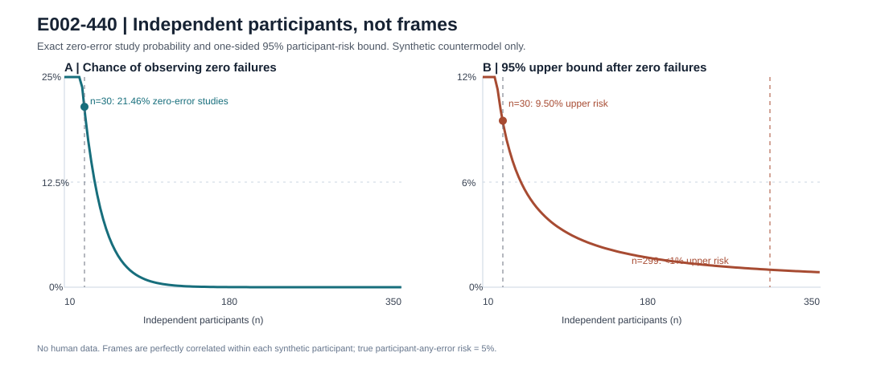

# E002-440 — clustered human-validation false reassurance

**Date:** 2026-10-25. **Frozen before implementation:** [E002_440_FROZEN.md](E002_440_FROZEN.md), commit `e51f880a6e3a581e965aedd4d2132b96ce805121`. **Evidence tier:** exact statistical calculation + 20,000 seeded *synthetic* clustered-study replicates + adversarial ledger tests. **No new human aperture sequences or physically validated speed bound.**

## New falsification of an unsafe validation shortcut

E002-371's shutter-gap result can be evaluated over thousands of camera intervals from a handful of participants. Those intervals do **not** supply thousands of independent observations of population-level safety. We froze a deliberately extreme but legitimate within-person dependence countermodel: 30 independent participants, 40 no-closure candidate intervals each, and a 5% probability per participant of belonging to a class that fails **all** 40 candidates. The remaining 95% fail none. The true *participant-level probability of at least one failure* is 5%, even though many entire studies observe zero errors.

| Precommitted quantity | Result |
| --- | ---: |
| Simulated independent studies | **20,000** |
| Zero-error studies | **4,301 (21.505%)** |
| Exact predicted zero-error probability | **21.4639%** |
| Correct 95% one-sided upper bound, 0/30 independent participants | **9.5034%** |
| Incorrect pseudo-independent upper bound, 0/1,200 frames | **0.24933%** |
| Zero-error participants required for an upper bound strictly below 1% | **299** |

The observed zero-error frequency differed from the exact prediction by 0.0411 percentage points, within the frozen ±1.2 percentage-point tolerance. Thus an apparently perfect 1,200-frame experiment can falsely suggest <0.25% risk when the true participant-level risk in this countermodel is 5%. The *valid* 30-participant bound is >9.5%. This is a falsification of the **independence assumption**, not a falsification of the mathematical E002-371 bound or an estimate of real human error.

## Product consequence and executable risk ledger

Added a standard-library, read-only ledger adjudicator that counts one failure per participant if any candidate is independently witnessed false; does not count abstention-only participants as successes; treats unresolved reference intervals, unlocked predictions, missing calibration/nuisance attestation and incomplete 40-candidate challenges as ineligible; rejects duplicate participant identifiers; and computes an exact one-sided binomial upper bound only over evaluable participants. Any unresolved participant blocks external release review. The human review candidate also requires a preregistered prospective evidence tier, independently sampled participants, 299 fully evaluated zero-error participants, and explicit external/physical/nuisance attestation. **These flags are not cryptographic evidence; the instrument never authorizes deployment.** The 299-person threshold is specific to a 95% confidence / 1% participant-level risk target and zero witnessed errors, *not* a universal sample-size rule.

The independent tests cover the exact zero-error formula, general binomial-CDF root, monotonicity, participant duplication, abstention, missing reference, unlocked predictions, incomplete challenge, false-certificate accounting, and a synthetic 299-participant review-gate case. All **17 local tests passed**. Hosted CI must be checked independently before claiming hosted verification.

## Novelty and primary-literature priority boundary

This is **not a new statistical theorem**. The exact binomial interval comes from Clopper & Pearson (1934), [DOI 10.1093/biomet/26.4.404](https://doi.org/10.1093/biomet/26.4.404). Nonindependent replicates and pseudoreplication are established, notably Hurlbert (1984), [DOI 10.2307/1942661](https://doi.org/10.2307/1942661). Lucent's contribution here is the falsifiable, reproducible *application* to its physical-closure release claims and a fail-closed prospective participant ledger. Confidence coverage requires iid participant sampling under the target condition; no claim transfers automatically to new devices, blink types or nuisance distributions.

## Reproduction

~~~sh
PYTHONPATH=research/observability python -m unittest discover -s research/observability -p 'test_e002_440_cluster_risk.py' -v
python research/observability/e002_440_cluster_risk.py --seed 440 --trials 20000 --output /tmp/e002_440.json
diff -u research/observability/E002_440_RESULTS.json /tmp/e002_440.json
~~~

See [machine-readable result](E002_440_RESULTS.json), [frozen protocol](E002_440_FROZEN.md), [executable instrument](e002_440_cluster_risk.py), [adversarial tests](test_e002_440_cluster_risk.py), and [prospective human handoff](E002_440_HUMAN_STUDY.md). No private human ledger was committed.

## Physical completion barrier

**E002-371 remains physically unvalidated.** The simulated clustered risk distribution is deliberately hypothetical; no physical human recordings, blinded anatomical labels, authenticated hardware exposure clock, or validated physiological velocity bound were obtained. Do not claim 5% real-world risk, 0.25% real-world risk, or validated no-closure capability. Retain `ABSTAIN_UNCALIBRATED` for hidden-closure guarantees, blink duration, PERCLOS and fatigue. The next decisive step is the existing independent 400–600-fps human study, not more media-metadata or theoretical polishing. Hush's branch/PR remain separate.
