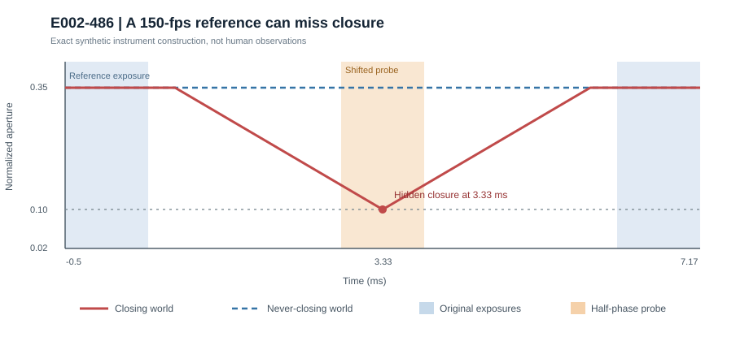

# E002-486 | The reference-camera blind spot

**2026-10-27.** Evidence: exact-rational synthetic instrument counterexample with independent numerical replay. **Human sequences processed: 0. Physical shutter acquisitions: 0.** Primary kernel E002-371. Protocol [E002_486_FROZEN.md](E002_486_FROZEN.md) was committed before implementation.

## New finding

A 150-fps reference video is **not a nonclosure oracle**. Even with independently verified frame timing and a 1-ms rectangular exposure, a closure can occur entirely within the 5.667-ms dark gap and produce exactly the same complete exposure-averaged sequence as a never-closing eyelid.

Let T be frame period, e the exposure width, b the known baseline aperture throughout neighboring exposure intervals, c the closure threshold, and V a genuine hard Lipschitz bound on aperture velocity. A baseline-to-closure-to-baseline excursion needs at least 2(b-c)/V time, while the dark gap has duration T-e. The **sharp conditional boundary** is

`R = V(T-e)/(2(b-c)) >= 1`.

A threshold-touching hidden closure exists if and only if R>=1; a strict below-threshold closure can be hidden if R>1, assuming the aperture range permits it. The piecewise-linear triangular trajectory attains this bound. **Important limitation:** the theorem requires a known baseline *throughout* the exposures, not merely the measured exposure averages. Averages alone permit additional ambiguity and cannot be used as instantaneous endpoint guarantees.

## Frozen fixture and controls

At 150 fps, T=20/3 ms, e=1 ms, baseline b=0.35, threshold c=0.10, and illustrative V=0.10 aperture-fraction/ms, R=17/15=1.133333; the critical V is 3/34=0.088235294 fraction/ms. A constant-open trajectory and a triangular dip reaching 0.10 at T/2 have **identical original-phase exposure averages of 0.35 at every frame**. A separate dip to 0.08 (strictly below threshold) is also invisible to the original exposure train.

An independent half-period-offset exposure probe yields 0.350 (open) versus 0.125 (closing). Under ±0.25-ms center jitter, the closing-world mean is at most 0.13125, by the exact expression c+V(e/4+j²/e) for |j|<=e/2.

**Prespecified failure preserved:** The frozen 0.15 detection threshold was proposed under ±10% gain and ±0.01 additive aperture-equivalent error, subject to arithmetic verification. The allowed moving-world output reaches **0.154375**, so guaranteed detection **fails**. The ±20% gain/±0.03 error negative control also fails (0.1875). An explicitly *exploratory*, tighter ±5% gain/±0.005 additive budget gives 0.1428125, below the frozen threshold; no real instrument is claimed to satisfy it. At V=0.08, R=68/75<1, so a closure cannot fit inside the gap while maintaining the known exposure-interval baseline.

## Verification

- [Python exact-rational simulator and 16 tests](e002_486_reference_alias.py): 16/16 passed locally.
- [Independent Node.js replay](e002_486_independent_replay.cjs): independent formulas plus 200,000-step numerical quadrature reproduced the principal values and a strict below-threshold hidden dip.
- [Deterministic aggregate](E002_486_AGGREGATE.json): explicit evidence tier, failed and successful conditional controls, and fail-closed product state.
- No human videos, anatomical ground truth, photodiode traces, measured exposure kernels, or independently measured physiological velocity bounds were acquired. Hosted CI success is not claimed until observed.

## Direct consequence for E002-485 and product

A 150-fps high-rate reference with no sampled closure must be labeled **REFERENCE_UNRESOLVED**, not anatomical nonclosure, even when all sampled frames look open. A sampled high-rate closure can still falsify a conditional low-rate exclusion. A secant slope measured from the same reference samples is **not** an instantaneous physical speed cap: in this construction every original-phase sampled aperture is constant, while a hidden excursion exists.

The [Guttmann-Flury et al. paper](https://doi.org/10.1038/s41597-025-04861-9) and [March 2026 dataset re-host](https://zenodo.org/records/18970793) remain positive-falsification candidates, not standalone nonclosure ground truth. Original paper specifies 150 fps; re-host says ~500 fps, requiring actual file timestamp verification. No participant archive was downloaded in this experiment.

### Decisive physical experiment

Use independently timed photodiode/logic-analyzer exposure calibration, then an independently instrumented moving aperture with matched closing/nonclosing trajectories. Freeze gain, blur, geometry, gaze, glasses/occlusion, brightness, dropped-frame, phase-jitter and clock-error budgets before held-out tests. Test original-phase aliasing, offset-phase recovery, and the R<1 negative control. Only then proceed to blinded human trajectories, retaining abstentions and all failures.

**Product release: BLOCKED. Physical claims: ABSTAIN_UNCALIBRATED.** No blink-duration, hidden-closure absence, PERCLOS, fatigue or medical claim is authorized. This result raises the standard for negative reference labels rather than validating a new phone measurement.
